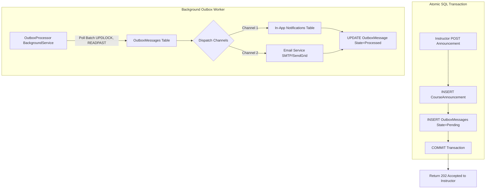
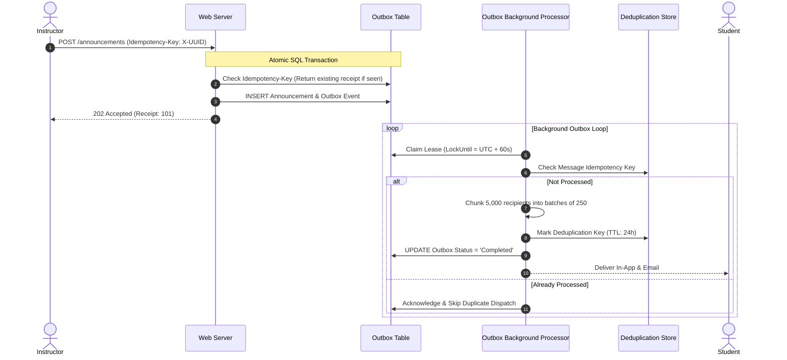

# Track 01 — Reliable Notification & Announcement Engine: The Transactional Outbox & Idempotency

**Rank:** 01  
**Real-World Analogy:** Slack channel notifications, Stripe webhook delivery, GitHub release notifications.  
**Core Question:** When an instructor posts an announcement to 5,000 enrolled students, how do you deliver in-app notifications and emails reliably without timing out the HTTP request, losing messages on a server crash, or spamming students with duplicates on network retries?

---

## Level 0: The Current Naive Baseline (What Exists Today)

### The Code in Academix
Look at [InstructorController.cs:1062-1135](file:///p:/Projects/Learning%20Management%20System/Controllers/InstructorController.cs#L1062-L1135) (`SendAnnouncement`):
```csharp
var enrolledUserIds = await _context.CourseEnrollments
    .Where(e => e.CourseId == courseId)
    .Select(e => e.UserId)
    .ToListAsync();

var notificationsList = new List<Notification>();
foreach (var studentId in enrolledUserIds)
{
    var notification = new Notification
    {
        UserId = studentId,
        Message = $"[{course.Title}] {message}",
        IsRead = false,
        CreatedAt = DateTime.Now
    };
    notificationsList.Add(notification);
}

_context.Notifications.AddRange(notificationsList);
await _context.SaveChangesAsync();
```

And look at the critical data leak in [StudentController.cs:170-173](file:///p:/Projects/Learning%20Management%20System/Controllers/StudentController.cs#L170-L173):
```csharp
// Unscoped query: Returns notifications belonging to ALL students across the university!
var notifications = await _context.Notifications
    .OrderByDescending(n => n.CreatedAt)
    .ToListAsync();
```

### Why Level 0 Fails
1. **Synchronous Fan-Out Bottleneck:** Generating 5,000 `Notification` objects and executing a multi-thousand-row insert inside an MVC HTTP POST request blocks the web worker thread for several seconds. If multiple instructors post announcements, web threads starve, leading to HTTP 504 Gateway Timeouts.
2. **Missing Retry & Multiple Channel Support:** If we add email dispatching inside this controller action, an SMTP timeout causes the entire HTTP request to fail. The database transaction rolls back, but an email might already have been sent!
3. **No Idempotency (Duplicate Spam):** If the database commit succeeds but the browser connection resets before receiving the `200 OK`, the instructor clicks "Send" again. All 5,000 students receive duplicate notifications.
4. **Data Privacy Violation (Finding F-04):** `StudentController.Announcements` forgets `Where(n => n.UserId == userId)`, exposing private academic notifications to unauthorized users.

---

## Level 1: The First Immediate Fix (Fire-and-Forget `Task.Run`)

### The Solution
To make the HTTP response instantaneous, engineers often reach for fire-and-forget:

```csharp
[HttpPost]
public IActionResult SendAnnouncement(int courseId, string message)
{
    var userId = GetCurrentUserId();
    
    // Fire and forget in the background!
    _ = Task.Run(async () =>
    {
        using var scope = _serviceScopeFactory.CreateScope();
        var context = scope.ServiceProvider.GetRequiredService<LmsContext>();
        var students = await context.CourseEnrollments.Where(e => e.CourseId == courseId).Select(e => e.UserId).ToListAsync();
        foreach (var sId in students)
        {
            context.Notifications.Add(new Notification { UserId = sId, Message = message });
        }
        await context.SaveChangesAsync();
    });

    return Accepted(new { message = "Announcement is being sent in the background" });
}
```

### The Emerging Bottleneck in Level 1: The Dual-Write & Volatility Trap
1. **Process Crash Data Loss:** `Task.Run` executes in volatile process memory. If IIS recycles the AppPool, Kubernetes restarts the pod, or the server loses power 50ms after the HTTP response was sent, **the background thread is abruptly terminated**. The announcement and notifications vanish into thin air without a trace.
2. **No Backpressure or Throttling:** If 20 instructors post announcements simultaneously, `Task.Run` spawns dozens of unconstrained background threads that compete for CPU and database connections, causing cascading database timeouts.

---

## Level 2: The Architectural Refactor (The Transactional Outbox Pattern)

### The Concept
To guarantee that business state and outbound messages are never out of sync, we apply the **Transactional Outbox Pattern**.
In a single atomic SQL transaction:
1. Save the business announcement in the database.
2. Insert an entry into an `OutboxMessages` table.
3. Commit the transaction.

A reliable background worker ([`BackgroundService`](https://learn.microsoft.com/en-us/dotnet/core/extensions/scoped-service)) continuously polls the outbox, claims pending batches, dispatches the messages, and marks them as completed.



### Database Schema for Outbox
```sql
CREATE TABLE OutboxMessages (
    OutboxId BIGINT IDENTITY(1,1) PRIMARY KEY,
    EventType NVARCHAR(100) NOT NULL,
    Payload NVARCHAR(MAX) NOT NULL,
    CreatedAt DATETIME2 NOT NULL DEFAULT GETUTCDATE(),
    ProcessedAt DATETIME2 NULL,
    RetryCount INT NOT NULL DEFAULT 0,
    Status NVARCHAR(50) NOT NULL DEFAULT 'Pending', -- 'Pending', 'Processing', 'Completed', 'Poisoned'
    LockUntil DATETIME2 NULL,
    ErrorMessage NVARCHAR(MAX) NULL
);
CREATE INDEX IX_OutboxMessages_Status_Lock ON OutboxMessages(Status, LockUntil);
```

### Worker Claiming Batch (Locking & Concurrency Safe)
```sql
-- Worker claims a batch of 50 messages safely across multiple instances
UPDATE TOP (50) OutboxMessages
SET Status = 'Processing',
    LockUntil = DATEADD(SECOND, 60, GETUTCDATE())
OUTPUT inserted.*
WHERE Status IN ('Pending', 'Failed') 
  AND (LockUntil IS NULL OR LockUntil < GETUTCDATE())
  AND RetryCount < 5;
```

### The Emerging Bottleneck in Level 2: At-Least-Once Delivery & Duplicates
The Outbox pattern guarantees **At-Least-Once** delivery, not Exactly-Once.
Consider this failure point:
1. Worker claims Outbox message #101.
2. Worker sends emails to SendGrid and inserts in-app notification rows.
3. Right before the worker executes `UPDATE OutboxMessages SET Status = 'Completed'`, the server loses network connectivity or crashes.
4. The 60-second lease (`LockUntil`) expires.
5. Worker #2 wakes up, sees Outbox message #101 still marked as `Pending`, and **sends the exact same notifications a second time**!

---

## Level 3: Production-Grade Architecture (Idempotency, Dead Letter Queues & High Fan-Out Batching)

### The Complete Production Architecture



### Production Patterns Implemented
1. **Request Idempotency Key (Publish Side):**
   - The instructor client generates an `Idempotency-Key: UUID`. If the network drops and the browser retries, the server finds the existing announcement by key and returns the original response with zero duplicate outbox records.
2. **Consumer Deduplication Key (Delivery Side):**
   - Each notification generated contains a unique deterministic `DeduplicationId = SHA256(AnnouncementId + "_" + StudentId)`.
   - The in-app `Notifications` table enforces a unique index:
     ```sql
     CREATE UNIQUE INDEX UQ_Notification_Deduplication ON Notifications(DeduplicationId);
     ```
   - If a replayed outbox batch tries to insert the notification again, SQL Server ignores or silently succeeds without creating duplicate notifications for the student.
3. **High Fan-Out Batching (Chunking):**
   - Instead of trying to insert 5,000 notifications in one giant query, the worker divides the enrolled student list into chunks of 250 recipients, processing each chunk in an isolated sub-transaction.
4. **Exponential Backoff with Jitter:**
   - On transient failure (e.g., SMTP rate limit), schedule retry with jitter:
     $$\text{Delay} = \min(300, 2^{\text{RetryCount}} \times 2) + \text{Random}(0, 3)\text{ seconds}$$
5. **Dead Letter Queue (DLQ) & Poison Message Isolation:**
   - If a message fails 5 times, transition status to `Poisoned`. The worker logs an alert with the stack trace and skips the message so the rest of the queue continues processing without being blocked.

---

## Hands-on Failure Injection & Verification Challenge

### Exercise: The Kill-Worker Replay Test
Simulate a worker crash immediately after sending notifications, and prove that the student receives **exactly one** in-app notification.

```csharp
[Fact]
public async Task Outbox_Worker_Crash_Does_Not_Duplicate_Student_Notifications()
{
    // Arrange: Create an announcement with an Outbox record
    var announcementId = await CreateAnnouncementWithOutboxRecord(courseId: 10, message: "Class postponed");

    // Act 1: Run worker iteration, but simulate crash right before marking Outbox as Completed
    await RunWorkerBatchWithSimulatedCrashAfterDispatch(announcementId);

    // Verify Outbox is still Pending because the worker crashed before commit
    var outboxItem = await GetOutboxRecord(announcementId);
    Assert.Equal("Pending", outboxItem.Status);

    // Act 2: Simulate worker restarting and reprocessing the pending outbox record
    await RunStandardWorkerIteration();

    // Assert: Check notification count for the student
    var studentNotifications = await GetStudentNotifications(studentId: 7);
    Assert.Single(studentNotifications); // Exactly ONE notification, zero duplicates!
}
```

### Verification Questions to Answer
1. Why does an in-process fire-and-forget (`Task.Run`) fail to guarantee message delivery when a server restarts?
2. What is the Dual-Write Problem, and how does the Transactional Outbox Pattern eliminate it?
3. Why is At-Least-Once delivery combined with Idempotent Consumers the standard industry pattern for reliable messaging?
