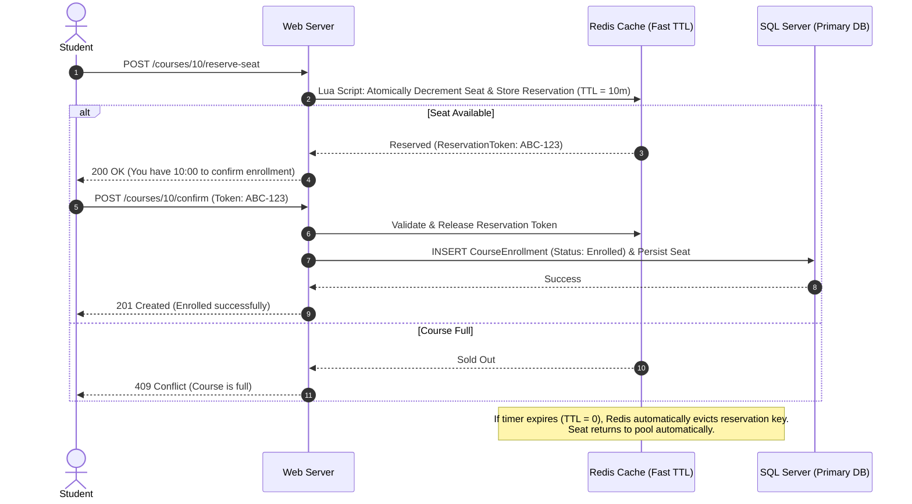

# Track 02 — Course Enrollment & Seat Reservation: Concurrency, Inventory & Contention

**Rank:** 02  
**Real-World Analogy:** Ticketmaster concert drops, Airline seat reservations, Amazon flash sales.  
**Core Question:** When 100 students click "Enroll" at the exact same millisecond for a course with only 2 remaining seats, how do you mathematically guarantee that exactly 2 succeed and 98 fail without corrupting data or locking up the database?

---

## Level 0: The Current Naive Baseline (What Exists Today)

### The Code in Academix
Look at [AdminController.cs:1100-1123](file:///p:/Projects/Learning%20Management%20System/Controllers/AdminController.cs#L1100-L1123):

```csharp
// AdminController.cs
var exists = await _context.CourseEnrollments
    .AnyAsync(e => e.CourseId == courseId && e.UserId == studentId);

if (!exists)
{
    var enrollment = new CourseEnrollment
    {
        CourseId = courseId,
        UserId = studentId,
        EnrolledAt = DateTime.Now,
        Status = "Enrolled"
    };

    _context.CourseEnrollments.Add(enrollment);

    // Update course count
    course.CurrentEnrollment++;

    await _context.SaveChangesAsync();
}
```

And in [AdminController.cs:1126-1150](file:///p:/Projects/Learning%20Management%20System/Controllers/AdminController.cs#L1126-L1150):
```csharp
_context.CourseEnrollments.Remove(enrollment);
if (course.CurrentEnrollment > 0)
    course.CurrentEnrollment--;
await _context.SaveChangesAsync();
```

### Why Level 0 Fails
1. **Time-of-Check to Time-of-Use (TOCTOU) Defect:** It doesn't check `CurrentEnrollment < MaxEnrollment` at all. Even if it did in C#, two concurrent threads both read `CurrentEnrollment = 29` (Max = 30). Both pass the `if` check, both insert an enrollment, and both increment to 30. The final enrollment count is 31, but `CurrentEnrollment` shows 30!
2. **Lost Updates:** Two threads running `course.CurrentEnrollment++` concurrently will overwrite each other's in-memory increment.
3. **Hard Deletion Destroys History:** When a student drops a course, `Remove(enrollment)` permanently purges the row, destroying quiz attempts, grades, and audit trails.

---

## Level 1: The Simplest Fix (In-Memory Locks & C# Invariant Checks)

### The Solution
Let's add the capacity check in C# and wrap it in a C# lock:

```csharp
// Level 1: C# Semaphore / Lock around the enrollment
private static readonly SemaphoreSlim _enrollmentLock = new SemaphoreSlim(1, 1);

public async Task<IActionResult> EnrollStudent(int courseId, int studentId)
{
    await _enrollmentLock.WaitAsync();
    try
    {
        var course = await _context.Courses.FindAsync(courseId);
        if (course.CurrentEnrollment >= course.MaxEnrollment)
            return BadRequest("Course is full");

        var exists = await _context.CourseEnrollments
            .AnyAsync(e => e.CourseId == courseId && e.UserId == studentId);
        if (exists) return BadRequest("Already enrolled");

        _context.CourseEnrollments.Add(new CourseEnrollment { CourseId = courseId, UserId = studentId, Status = "Enrolled" });
        course.CurrentEnrollment++;
        await _context.SaveChangesAsync();
        return Ok();
    }
    finally
    {
        _enrollmentLock.Release();
    }
}
```

### The Emerging Bottleneck in Level 1
1. **Single-Process Constraint:** A C# `SemaphoreSlim` exists only in the memory of a single web server process. As soon as you deploy two instances behind a load balancer, Node A's lock has zero knowledge of Node B. Race conditions immediately return!
2. **Global Throughput Bottleneck:** A global lock serializes **all** course enrollments across the entire university. A student enrolling in Biology 101 blocks a student enrolling in History 201. Latency spikes and threads starve.

---

## Level 2: The Relational Fix (Database-Level Atomicity & OCC)

### The Concept
Push concurrency control down to the single source of truth: **SQL Server**.
We have two distinct options to compare:
1. **Pessimistic Locking / Atomic Conditional SQL Update (Compare-And-Swap):**
2. **Optimistic Concurrency Control (OCC) with `RowVersion`:**

### Approach A: Atomic Conditional Update (Compare-And-Swap / CAS)
Instead of loading the entity into memory, modifying it, and saving it, let SQL Server evaluate the capacity condition atomically in the `UPDATE` statement:

```sql
-- Atomic CAS at the database engine level
UPDATE Courses
SET CurrentEnrollment = CurrentEnrollment + 1
WHERE CourseId = @CourseId AND CurrentEnrollment < MaxEnrollment;
```

In EF Core / C#:
```csharp
// Execute atomic conditional update
var rowsAffected = await _context.Database.ExecuteSqlInterpolatedAsync(
    $"UPDATE Courses SET CurrentEnrollment = CurrentEnrollment + 1 WHERE CourseId = {courseId} AND CurrentEnrollment < MaxEnrollment"
);

if (rowsAffected == 0)
{
    // Either course doesn't exist, or it is full!
    return BadRequest("Course is full or does not exist.");
}

// Seat is reserved; insert the enrollment row
_context.CourseEnrollments.Add(new CourseEnrollment 
{ 
    CourseId = courseId, 
    UserId = studentId, 
    EnrolledAt = DateTime.UtcNow, 
    Status = "Enrolled" 
});
await _context.SaveChangesAsync();
```

### Approach B: Optimistic Concurrency Control (`rowversion`)
Add a concurrency token to [Course.cs](file:///p:/Projects/Learning%20Management%20System/Models/Course.cs):
```csharp
public byte[] RowVersion { get; set; } = null!;
```
In `LmsContext.cs`:
```csharp
modelBuilder.Entity<Course>()
    .Property(c => c.RowVersion)
    .IsRowVersion();
```
When two students attempt to enroll simultaneously, EF Core emits:
```sql
UPDATE Courses SET CurrentEnrollment = @p0 WHERE CourseId = @p1 AND RowVersion = @originalRowVersion;
```
The first student succeeds. The second student's update affects `0` rows because the `RowVersion` has changed. EF Core immediately throws a `DbUpdateConcurrencyException`, allowing you to catch it, reload the fresh seat count, and inform the user.

### The Emerging Bottleneck in Level 2
1. **The Cart Abandonment / Checkout Problem:** Real enrollments often involve multi-step user actions (e.g., resolving prerequisite conflicts, submitting advisor approval, paying tuition). If seat decrement happens immediately, a student might hold a seat forever without paying. If it happens at the end, someone else takes the seat while they were filling out paperwork.
2. **High Contention Retry Thrashing:** Under extreme concurrency (e.g., 10,000 students for 100 seats), OCC throws 9,900 concurrency exceptions. Retrying in loops creates a thundering herd on SQL Server.

---

## Level 3: Production-Grade Architecture (Two-Phase Lease Reservation with Redis TTL)

### The Architecture
We introduce a **Two-Phase Reservation Pattern** (similar to Ticketmaster's "Your tickets are held for 10 minutes" timer):



### Atomic Lua Script in Redis
```lua
-- Keys: [1] course:inventory:{id}, [2] course:reservations:{id}
-- Args: [1] studentId, [2] ttlSeconds
local available = tonumber(redis.call('get', KEYS[1]))
if available and available > 0 then
    redis.call('decr', KEYS[1])
    redis.call('setex', KEYS[2] .. ':' .. ARGV[1], ARGV[2], 'RESERVED')
    return 1 -- Success
else
    return 0 -- Sold out
end
```

### Soft-State & Append-Only History
In SQL Server:
- `CourseEnrollments` transitions to a formal state machine: `Reserved` $\to$ `Enrolled` $\to$ `Withdrawn`.
- When a student drops a course, never delete the row:
  ```csharp
  enrollment.Status = "Withdrawn";
  enrollment.WithdrawnAt = DateTime.UtcNow;
  _context.EnrollmentAuditLogs.Add(new EnrollmentAuditLog
  {
      EnrollmentId = enrollment.EnrollmentId,
      Action = "Drop",
      ActorId = currentUserId,
      Timestamp = DateTime.UtcNow,
      Reason = reason
  });
  ```

---

## Hands-on Failure Injection & Verification Challenge

### Exercise 1: The Parallel Race Harness
Write an integration test in `tests/Lms.IntegrationTests` that uses `Parallel.For` or `Task.WhenAll` to spawn **20 concurrent HTTP requests** trying to enroll in a course with `MaxEnrollment = 5` and `CurrentEnrollment = 4` (only 1 seat left).

```csharp
[Fact]
public async Task Concurrent_Enrollment_Never_Exceeds_Max_Capacity()
{
    // Arrange: 1 seat remaining
    int courseId = 99;
    var clientTasks = Enumerable.Range(1, 20).Select(async studentId =>
    {
        return await PostEnrollmentRequest(courseId, studentId);
    });

    // Act
    var results = await Task.WhenAll(clientTasks);

    // Assert
    var successCount = results.Count(r => r.IsSuccessStatusCode);
    var course = await FetchCourseFromDb(courseId);

    Assert.Equal(1, successCount);
    Assert.Equal(5, course.CurrentEnrollment);
}
```

### Verification Questions to Answer
1. In Level 0, what was the observed `CurrentEnrollment` count after 20 parallel threads executed?
2. Why is an atomic `UPDATE ... WHERE CurrentEnrollment < MaxEnrollment` superior to reading the entity first in EF Core?
3. What happens if the server crashes after decrementing the seat in Redis but before writing to SQL Server in Level 3? How does TTL leasing guarantee self-healing?
