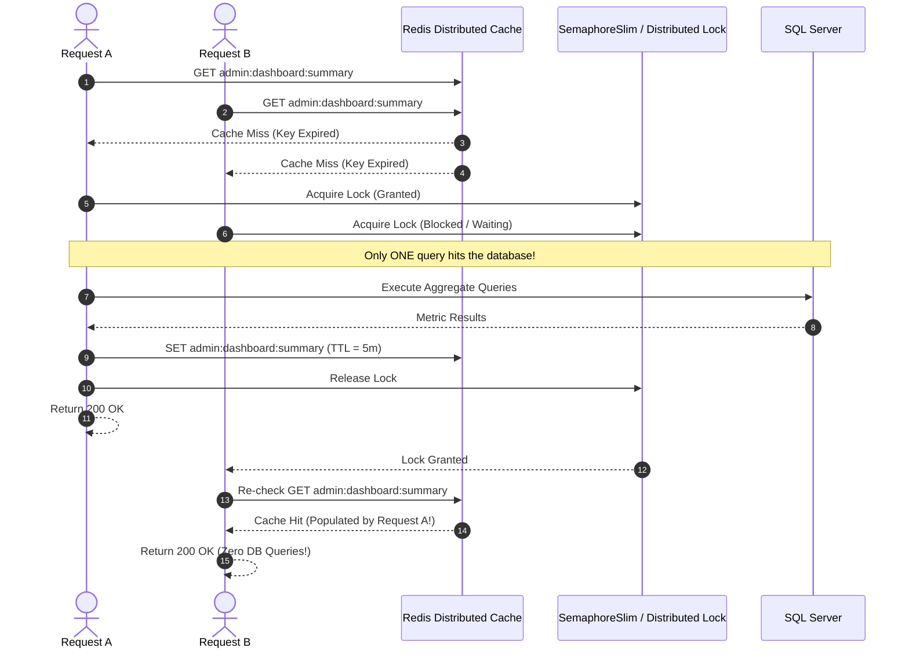
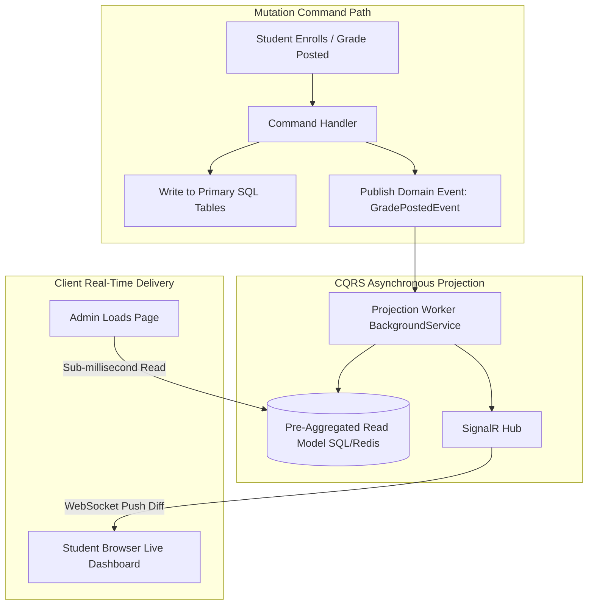

# Track 04 — Read-Heavy Dashboards & Analytics: CQRS, Caching & Real-Time Push

**Rank:** 04  
**Real-World Analogy:** Twitter timeline feed, Robinhood live portfolio dashboard, Canvas/Blackboard student portal.  
**Core Question:** When 5,000 students and admins continuously view and poll their dashboards, how do you maintain sub-10ms response times without melting SQL Server with un-indexed table scans and expensive aggregation queries?

---

## Level 0: The Current Naive Baseline (What Exists Today)

### The Code in Academix
Look at [AdminController.cs:37-109](file:///p:/Projects/Learning%20Management%20System/Controllers/AdminController.cs#L37-L109) (`Admin/Dashboard`):
```csharp
// Executed on EVERY single page load:
var totalUsers = await _context.Users.CountAsync();
var totalCourses = await _context.Courses.CountAsync();
var activeCourses = await _context.Courses.Where(c => c.Status == "Active").CountAsync();
var courseEnrollments = await _context.CourseEnrollments.CountAsync();
var aiGenerations = await _context.AigeneratedContents.CountAsync();

var lastMonth = DateTime.Now.AddDays(-30);
var newUsersLastMonth = await _context.Users.CountAsync(u => u.CreatedAt >= lastMonth);
var newEnrollmentsLastMonth = await _context.CourseEnrollments.CountAsync(e => e.EnrolledAt >= lastMonth);

// Plus heavy un-indexed joins and group by:
var recentActivity = recentUsers.Concat(recentCourses).OrderByDescending(a => a.Date).Take(5).ToList();
var aiUsage = await _context.AigeneratedContents
    .Include(c => c.Aimodel)
    .GroupBy(c => c.Aimodel.ModelName)
    .Select(g => new { Model = g.Key, Count = g.Count() })
    .ToListAsync();
```

And look at [StudentController.cs:725-760](file:///p:/Projects/Learning%20Management%20System/Controllers/StudentController.cs#L725-L760) (`GetDashboardUpdates`):
```csharp
// Polled repeatedly by client browsers every 30-60 seconds:
var unreadCount = await _context.Notifications
    .CountAsync(n => n.UserId == userId && !n.IsRead);

var upcomingDeadlines = await _context.Quizzes
    .Where(q => q.DueDate != null && q.DueDate > DateTime.Now && q.DueDate <= DateTime.Now.AddHours(48))
    .Where(q => _context.CourseEnrollments.Any(e => e.UserId == userId && e.CourseId == q.CourseId))
    .Where(q => !_context.QuizAttempts.Any(qa => qa.QuizId == q.QuizId && qa.UserId == userId && qa.SubmittedAt != null))
    .Select(q => new {
        title = q.Title,
        courseName = q.Course.Title,
        dueInMinutes = (int)EF.Functions.DateDiffMinute(DateTime.Now, q.DueDate),
        dueDate = q.DueDate
    })
    .OrderBy(q => q.dueDate)
    .ToListAsync();
```

### Why Level 0 Fails
1. **Asymmetric Load Disparity:** 95% of traffic in an LMS consists of read requests (viewing dashboards, checking grades, reading lecture notes), while writes represent less than 5%. Performing 10 synchronous database table scans for every read request wastes database CPU on identical computations.
2. **Polling Exhaustion:** With 2,000 active students polling `GetDashboardUpdates` every 30 seconds, SQL Server processes 4,000 complex queries with correlated subqueries every minute, leading to high disk I/O and query plan cache bloat.

---

## Level 1: The First Immediate Fix (In-Memory Cache-Aside with `IMemoryCache`)

### The Solution
Wrap the dashboard calculation in ASP.NET Core's built-in `IMemoryCache`:

```csharp
public async Task<IActionResult> Dashboard()
{
    const string cacheKey = "AdminDashboardMetrics";
    
    if (!_memoryCache.TryGetValue(cacheKey, out AdminDashboardViewModel model))
    {
        // Compute from database
        model = await ComputeDashboardMetricsFromDb();

        var cacheOptions = new MemoryCacheEntryOptions()
            .SetAbsoluteExpiration(TimeSpan.FromMinutes(5));

        _memoryCache.Set(cacheKey, model, cacheOptions);
    }

    return View(model);
}
```

### The Emerging Bottleneck in Level 1: The Cache Stampede (Thundering Herd)
1. **The Cache Stampede:** What happens when the 5-minute cache TTL expires under peak traffic? If 200 admins or requests hit the dashboard at the exact same millisecond, `TryGetValue` returns `false` for **all 200 requests**. All 200 threads simultaneously execute `ComputeDashboardMetricsFromDb()`, causing a massive sudden CPU and I/O spike that freezes the database.
2. **Multi-Node Split-Brain:** In-memory cache is local to a single server instance. If Node A updates a course, Node B's local cache remains stale for up to 5 minutes.

---

## Level 2: The Architectural Refactor (Distributed Caching & Stampede Mutex)

### The Concept
Move the cache tier out of the web process into a **Distributed Cache (Redis)** using `IDistributedCache`. Protect the database from cache stampedes using a **Single-Flight Lock (Mutex / Semaphore)** so that exactly **one** worker queries the database on a cache miss, while all other requests await that single result.



### Single-Flight Stampede Guard in C#
```csharp
public class DistributedCacheStampedeGuard
{
    private static readonly ConcurrentDictionary<string, SemaphoreSlim> _locks = new();

    public async Task<T> GetOrCreateAsync<T>(
        IDistributedCache cache, 
        string key, 
        TimeSpan ttl, 
        Func<Task<T>> factory)
    {
        // 1. First fast check in cache
        var cachedData = await cache.GetStringAsync(key);
        if (cachedData != null)
            return JsonSerializer.Deserialize<T>(cachedData)!;

        // 2. Cache miss: Obtain semaphore for this specific key
        var keyLock = _locks.GetOrAdd(key, _ => new SemaphoreSlim(1, 1));
        await keyLock.WaitAsync();
        try
        {
            // 3. Double-check cache inside the lock (another thread may have populated it)
            cachedData = await cache.GetStringAsync(key);
            if (cachedData != null)
                return JsonSerializer.Deserialize<T>(cachedData)!;

            // 4. Exactly ONE thread executes the expensive query
            var result = await factory();
            var serialized = JsonSerializer.Serialize(result);
            await cache.SetStringAsync(key, serialized, new DistributedCacheEntryOptions
            {
                AbsoluteExpirationRelativeToNow = ttl
            });

            return result;
        }
        finally
        {
            keyLock.Release();
        }
    }
}
```

### The Emerging Bottleneck in Level 2
1. **Cache Invalidation Complexity:** As features grow, invalidating cached aggregates becomes difficult. When a student drops a course, which cache keys must be purged? If you forget one key, data is permanently inconsistent.
2. **Polling Waste Remains:** Even with Redis, 5,000 students polling every 30 seconds still generate 10,000 HTTP network roundtrips per minute, consuming network sockets and load balancer connections.

---

## Level 3: Production-Grade Architecture (CQRS Materialized Projections & SignalR Push)

### The Complete Production Architecture



### 1. CQRS (Command Query Responsibility Segregation)
- **Command Path (Writes):** Normalized, relational, strictly validated ([CourseEnrollment](file:///p:/Projects/Learning%20Management%20System/Models/CourseEnrollment.cs), [Grade](file:///p:/Projects/Learning%20Management%20System/Models/Grade.cs)).
- **Query Path (Reads):** Denormalized, pre-aggregated, read-optimized tables or documents (`DashboardSummaries`, `StudentProgressSummaries`).
- When a grade is posted, an event `GradePostedEvent` is published. A projection worker updates the pre-aggregated summary table in the background. When an admin loads the dashboard, the query is a simple `SELECT * FROM DashboardSummaries WHERE Id = 1` requiring **zero JOINs and zero COUNTs**.

### 2. WebSocket Push via SignalR (Goodbye HTTP Polling!)
Replace client-side `setInterval()` polling in `student.js` with a persistent ASP.NET Core SignalR connection:

```csharp
// StudentDashboardHub.cs
public class StudentDashboardHub : Hub
{
    public override async Task OnConnectedAsync()
    {
        var userId = Context.UserIdentifier;
        if (userId != null)
        {
            await Groups.AddToGroupAsync(Context.ConnectionId, $"User_{userId}");
        }
        await base.OnConnectedAsync();
    }
}
```

When an announcement or grade is published:
```csharp
// Push directly to the student's open browser session instantly:
await _hubContext.Clients.Group($"User_{studentId}")
    .SendAsync("ReceiveDashboardUpdate", new { unreadCount = 4, newGrade = "A" });
```

---

## Hands-on Failure Injection & Verification Challenge

### Exercise: The 500-Connection Stampede Benchmark
Write a benchmark test using [k6](https://k6.io/) or `HttpClient` spawning 500 concurrent requests to `/Admin/Dashboard`.

1. **Test A (Level 0):** Run 500 concurrent requests against Level 0. Record SQL Server CPU percentage, memory allocations, and p95 latency.
2. **Test B (Level 2 with Stampede Guard):** Run 500 concurrent requests against Level 2 with a cold cache.
3. **Compare Results:** Verify that SQL Server receives **exactly 1 execution** of the aggregation query, while 499 requests are served in under 15ms.

### Verification Questions to Answer
1. What is the difference between Cache-Aside (Look-Aside) and Write-Through caching?
2. Why does probabilistic early expiration (XFetch) eliminate cache stampedes without requiring distributed locks?
3. What are the operational costs of maintaining persistent WebSockets (SignalR) compared to stateless HTTP polling?
