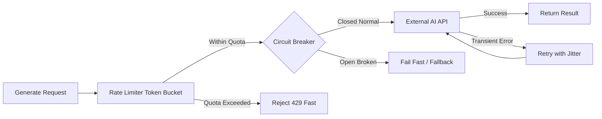
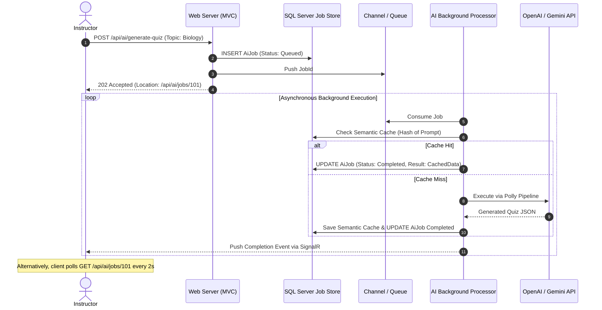

# Track 05 — Resilient AI Generation Pipeline: Rate Limiting, Circuit Breakers & Async Job Queues

**Rank:** 05  
**Real-World Analogy:** OpenAI / Anthropic API integrations, Stripe payment processing, Third-party translation services.  
**Core Question:** When instructors generate 20-question quizzes or course summaries using external LLMs that take 10–25 seconds to complete, how do you prevent third-party latency and outages from exhausting your web server threads and crashing the entire LMS?

---

## Level 0: The Current Naive Baseline (What Exists Today)

### The Code in Academix
Look at [AdminController.cs:98-104](file:///p:/Projects/Learning%20Management%20System/Controllers/AdminController.cs#L98-L104) and the models [Aimodel.cs](file:///p:/Projects/Learning%20Management%20System/Models/Aimodel.cs), [AigeneratedContent.cs](file:///p:/Projects/Learning%20Management%20System/Models/AigeneratedContent.cs), and [Aiinteraction.cs](file:///p:/Projects/Learning%20Management%20System/Models/Aiinteraction.cs).

When AI generation is invoked directly within a controller action:
```csharp
[HttpPost]
public async Task<IActionResult> GenerateQuizContent(int courseId, string topic)
{
    // Synchronous external HTTP call to OpenAI / Gemini
    var response = await _httpClient.PostAsJsonAsync("https://api.openai.com/v1/chat/completions", payload);
    var content = await response.Content.ReadAsStringAsync();

    var aiContent = new AigeneratedContent { CourseId = courseId, Content = content };
    _context.AigeneratedContents.Add(aiContent);
    await _context.SaveChangesAsync();

    return View("QuizGenerated", aiContent);
}
```

### Why Level 0 Fails
1. **Thread Pool Starvation (Cascading Failure):** Generating complex educational content takes 10–25 seconds. During this entire time, an ASP.NET Core request thread is tied up waiting on network I/O. If 40 instructors click "Generate Quiz" at the same time, the server runs out of available threads. Unrelated students trying to log in or view a lecture receive `503 Service Unavailable`.
2. **Third-Party Outages Crash Your App:** If the AI provider has an outage or returns `500 Internal Server Error`, your controller crashes with an unhandled exception.
3. **HTTP 429 Rate-Limit Cascades:** Third-party APIs enforce strict token/request limits (e.g., 60 requests/minute). When your users exceed this quota, every subsequent request fails.

---

## Level 1: The First Immediate Fix (Client Timeouts & Naive Retries)

### The Solution
Add a cancellation timeout and a naive retry loop:

```csharp
for (int attempt = 1; attempt <= 3; attempt++)
{
    try
    {
        using var cts = new CancellationTokenSource(TimeSpan.FromSeconds(15));
        var response = await _httpClient.PostAsJsonAsync(url, payload, cts.Token);
        if (response.IsSuccessStatusCode)
            return await response.Content.ReadAsStringAsync();
    }
    catch (Exception) when (attempt < 3)
    {
        // Wait 1 second and retry
        await Task.Delay(1000);
    }
}
throw new Exception("AI generation failed after 3 attempts.");
```

### The Emerging Bottleneck in Level 1: The Retry Storm
1. **The Retry Storm & Rate-Limit Ban:** When the AI provider returns `429 Too Many Requests`, immediately retrying after 1 second amplifies the traffic spike. The provider flags your IP for abuse and temporarily bans your API key.
2. **Synchronous Connection Drop:** The instructor's browser is still spinning for up to 45 seconds ($3 \times 15\text{s}$). If the instructor gets impatient and navigates away or refreshes the page, the server keeps executing the remaining retries, burning expensive API tokens for a response nobody will ever see!

---

## Level 2: The Architectural Refactor (Polly v8 Resilience Pipeline & Token Bucket Rate Limiting)

### The Concept
Isolate the third-party boundary using [**Polly v8**](https://github.com/App-vNext/Polly) resilience strategies:
1. **Token Bucket Rate Limiter:** Prevent exceeding provider quotas locally before making the network call.
2. **Circuit Breaker:** If 5 consecutive calls fail, "trip" the circuit open. For the next 30 seconds, fail immediately without hitting the external network.
3. **Exponential Backoff with Full Jitter:** Space out retries with randomized delays to break synchronization:
   $$\text{Delay} = \text{Random}(0, \min(\text{MaxDelay}, \text{BaseDelay} \times 2^{\text{Attempt}}))$$



### Configuring Polly v8 in .NET 8
```csharp
var resiliencePipeline = new ResiliencePipelineBuilder<HttpResponseMessage>()
    .AddRateLimiter(new TokenBucketRateLimiter(new TokenBucketRateLimiterOptions
    {
        TokenLimit = 50,
        QueueLimit = 10,
        ReplenishmentPeriod = TimeSpan.FromMinutes(1),
        TokensPerPeriod = 50
    }))
    .AddRetry(new RetryStrategyOptions<HttpResponseMessage>
    {
        MaxRetryAttempts = 3,
        BackoffType = DelayBackoffType.Exponential,
        UseJitter = true,
        BaseDelay = TimeSpan.FromSeconds(2),
        ShouldHandle = new PredicateBuilder<HttpResponseMessage>()
            .HandleResult(r => r.StatusCode == HttpStatusCode.TooManyRequests || (int)r.StatusCode >= 500)
    })
    .AddCircuitBreaker(new CircuitBreakerStrategyOptions<HttpResponseMessage>
    {
        FailureRatio = 0.5,
        SamplingDuration = TimeSpan.FromSeconds(30),
        MinimumThroughput = 10,
        BreakDuration = TimeSpan.FromSeconds(30)
    })
    .AddTimeout(TimeSpan.FromSeconds(20))
    .Build();
```

### The Emerging Bottleneck in Level 2
Even with a circuit breaker and rate limiter, **long-running HTTP requests remain synchronous**. If 50 instructors trigger 20-second generations, you still have 50 open HTTP connections held open between browsers and your web server.

---

## Level 3: Production-Grade Architecture (Asynchronous Job Queue 202 Pattern & Semantic Cache)

### The Architecture
Decouple the web request from execution using the **Asynchronous Job Pattern (HTTP 202 Accepted)**:



### 1. The HTTP 202 Accepted Response
```csharp
[HttpPost("api/ai/generate-quiz")]
public async Task<IActionResult> EnqueueQuizGeneration([FromBody] GenerateQuizRequest model)
{
    var jobId = Guid.NewGuid();
    var job = new AiJob
    {
        JobId = jobId,
        UserId = GetCurrentUserId(),
        Topic = model.Topic,
        Status = "Queued",
        CreatedAt = DateTime.UtcNow
    };

    _context.AiJobs.Add(job);
    await _context.SaveChangesAsync();

    await _jobChannel.Writer.WriteAsync(jobId);

    // Return 202 Accepted immediately (< 10ms response time!)
    return AcceptedAtAction(nameof(GetJobStatus), new { id = jobId }, new { jobId, status = "Queued" });
}
```

### 2. Semantic Prompt Caching
Before invoking expensive external LLM tokens, compute a deterministic hash of the normalized prompt parameters:
$$\text{Key} = \text{SHA256}(\text{Model} + \text{"\_"} + \text{Topic} + \text{"\_"} + \text{NumQuestions})$$
If an identical prompt was submitted recently, reuse the parsed content instantly. Cost = $0.00, Latency = 4ms.

---

## Hands-on Failure Injection & Verification Challenge

### Exercise: The Circuit Breaker Tripping Experiment
Set up a mock HTTP server (using `WireMock.Net` or a custom `DelegatingHandler`) simulating OpenAI.

```csharp
[Fact]
public async Task Circuit_Breaker_Trips_After_Consecutive_500_Errors()
{
    // Arrange: Configure mock to return 500 Internal Server Error
    var mockHandler = new MockFailingHttpHandler(statusCode: HttpStatusCode.InternalServerError);
    var client = CreateClientWithPollyPipeline(mockHandler);

    // Act: Fire 10 consecutive requests
    for (int i = 0; i < 5; i++)
    {
        await Assert.ThrowsAnyAsync<Exception>(() => client.PostAsync("/test", null));
    }

    // Assert: The 6th request must fail with BrokenCircuitException INSTANTLY (< 1ms)
    // without even calling the mock handler!
    var sw = Stopwatch.StartNew();
    var ex = await Assert.ThrowsAsync<BrokenCircuitException>(() => client.PostAsync("/test", null));
    sw.Stop();

    Assert.True(sw.ElapsedMilliseconds < 5, "Circuit breaker failed to fail fast!");
}
```

### Verification Questions to Answer
1. Why does the Asynchronous Job Pattern (202 Accepted) protect web servers from slow third-party dependencies?
2. What is the difference between a "Half-Open" and "Open" state in a Circuit Breaker?
3. How does adding randomized jitter to exponential backoff prevent the "thundering herd" on a recovering upstream service?
