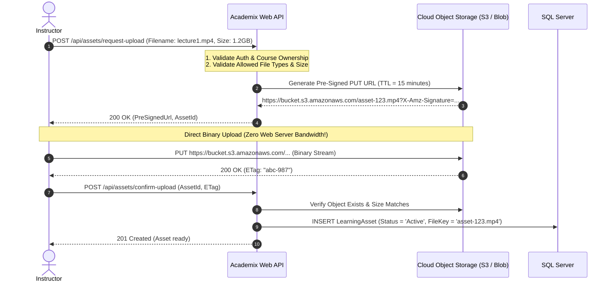

# Track 06 — Large Asset Ingestion & Storage: Pre-Signed URLs & CDN Edge Offloading

**Rank:** 06  
**Real-World Analogy:** YouTube video uploads, Coursera / Udemy lecture streaming, Google Drive file sharing.  
**Core Question:** When instructors upload 2 GB lecture recordings and high-resolution course materials, how do you ingest and distribute these files without melting your web server RAM, saturating server network pipes, or allowing unauthorized students to hotlink copyrighted content?

---

## Level 0: The Current Naive Baseline (What Exists Today)

### The Code in Academix
Look at [InstructorController.cs:433-475](file:///p:/Projects/Learning%20Management%20System/Controllers/InstructorController.cs#L433-L475) (`AddLearningAsset`) and [LearningAsset.cs](file:///p:/Projects/Learning%20Management%20System/Models/LearningAsset.cs):

```csharp
[HttpPost]
public async Task<IActionResult> AddLearningAsset(int? courseId, int? lectureId, string title, string assetType, string fileUrl)
{
    // Binds a raw string URL from a form input!
    var asset = new LearningAsset
    {
        LectureId = lectureId,
        CourseId = courseId,
        Title = title,
        AssetType = assetType,
        FileUrl = fileUrl // <-- Plain text URL string!
    };
    _context.LearningAssets.Add(asset);
    await _context.SaveChangesAsync();
}
```

### Why Level 0 Fails
1. **No Actual File Ingestion:** The LMS expects the instructor to supply an external link rather than hosting institutional assets.
2. **The "Local Disk" Trap (If implemented via `IFormFile`):**
   ```csharp
   // The typical naive approach:
   using var stream = new FileStream($"wwwroot/uploads/{file.FileName}", FileMode.Create);
   await file.CopyToAsync(stream);
   ```
   - **Local Disk Isolation:** If you run two web server instances (Node A and Node B) behind a load balancer, a video uploaded to Node A cannot be streamed by a student routed to Node B.
   - **Disk Exhaustion:** A few dozen 4K video lectures will fill the server's local hard drive, causing the operating system and SQL Server to crash.

---

## Level 1: The First Immediate Fix (Web Proxy Streaming to Cloud Storage)

### The Solution
Stream the incoming file from the controller directly into an AWS S3 or Azure Blob Storage bucket:

```csharp
[HttpPost]
public async Task<IActionResult> UploadAsset(IFormFile file, int courseId)
{
    // Stream file through web server into cloud storage
    using var stream = file.OpenReadStream();
    var putRequest = new PutObjectRequest
    {
        BucketName = "academix-assets",
        Key = $"courses/{courseId}/{file.FileName}",
        InputStream = stream
    };
    await _s3Client.PutObjectAsync(putRequest);

    return Ok();
}
```

### The Emerging Bottleneck in Level 1: The Double-Bandwidth Proxy Trap
1. **Double Bandwidth Saturation:** When an instructor uploads a 1 GB video:
   - 1 GB traverses the network from the Instructor's laptop to your Web Server.
   - Another 1 GB traverses the network from your Web Server to AWS S3.
   - Your web server's Network Interface Card (NIC) handles **2 GB of bandwidth** for a single 1 GB file, while ASP.NET request threads are held open for minutes.
2. **Brittle Connections:** If the instructor's home Wi-Fi drops at 99%, the entire upload fails. The web server has to discard the partially streamed data, and the instructor must start over from 0%.

---

## Level 2: The Architectural Refactor (Direct-to-Storage with Pre-Signed URLs)

### The Concept
Completely bypass the web application server! Let the client browser upload the file **directly to Cloud Object Storage (S3 / Azure Blob)** using a short-lived, cryptographically signed URL generated by the LMS.



### Generating Pre-Signed URL in C#
```csharp
[HttpPost("api/assets/request-upload")]
public IActionResult GetPreSignedUploadUrl([FromBody] UploadRequest model)
{
    if (!IsInstructor() || model.SizeBytes > 2L * 1024 * 1024 * 1024) // 2GB limit
        return BadRequest("Invalid request or file exceeds 2GB limit.");

    var fileKey = $"courses/{model.CourseId}/{Guid.NewGuid()}{Path.GetExtension(model.Filename)}";

    var request = new GetPreSignedUrlRequest
    {
        BucketName = "academix-assets",
        Key = fileKey,
        Verb = HttpVerb.PUT,
        Expires = DateTime.UtcNow.AddMinutes(15),
        ContentType = model.ContentType
    };

    string presignedUrl = _s3Client.GetPreSignedURL(request);

    return Ok(new { presignedUrl, fileKey });
}
```

### The Emerging Bottleneck in Level 2
1. **Malware / Unverified Uploads:** An instructor could upload a malicious `.exe` file or infected macro. Serving this file directly to students creates a major security liability.
2. **Public Hotlinking & Data Theft:** If S3 files are public, anyone who inspects the network tab can share the video URL on Reddit or Discord. Non-paying students can stream institutional lectures for free.

---

## Level 3: Production-Grade Architecture (Async Quarantine Scanning & Signed CDN Cookies)

### The Complete Production Architecture

```mermaid
flowchart TD
    subgraph Ingestion Tier
        A[Client Browser] -->|Pre-Signed S3 Multipart Upload| B[(Quarantine S3 Bucket)]
        B -->|S3 Event: ObjectCreated| C[AssetProcessing Worker]
    end

    subgraph Security & Transcoding Pipeline
        C --> D{Antivirus Scanner ClamAV}
        D -->|Infected| E[Delete & Alert Instructor]
        D -->|Clean| F[FFmpeg Transcoder: Generate HLS / 720p / 1080p]
        F --> G[(Production Clean S3 Bucket)]
    end

    subgraph Content Delivery Tier
        H[Student Browser] -->|GET /lectures/10/stream| I[Academix Web API]
        I -->|Verify Course Enrollment| J[Issue Cloudflare / CloudFront Signed Cookie (TTL 2h)]
        J --> H
        H -->|Stream Video with Signed Cookie| K[CDN Edge Cache]
        K -->|Cache Miss| G
    end
```

### Production Patterns Implemented
1. **Asynchronous Quarantine & Transcoding Pipeline:**
   - Files are uploaded into a private `Quarantine` bucket.
   - An event triggers an asynchronous background worker that scans the file for malware using ClamAV.
   - For video assets, the worker generates adaptive bitrate streams (HLS/DASH) so students on mobile phones stream 480p while desktop students stream 1080p.
2. **Signed CDN Cookies & CloudFront Edge Caching:**
   - The production S3 bucket is strictly private (blocked from public access).
   - Students must authenticate with the LMS. If their [CourseEnrollment](file:///p:/Projects/Learning%20Management%20System/Models/CourseEnrollment.cs) is valid, the server sets a short-lived **Signed CDN Cookie** (Cloudflare / AWS CloudFront).
   - The student streams the video from the nearest edge CDN server. Hotlinking by non-enrolled users is cryptographically blocked at the edge.

---

## Hands-on Failure Injection & Verification Challenge

### Exercise: Pre-Signed URL Expiration & Size Limit Enforcement
Verify that direct-to-storage uploads enforce tamper-proof expiration and size constraints.

```csharp
[Fact]
public async Task Expired_PreSigned_URL_Rejects_Upload()
{
    // Arrange: Generate pre-signed URL with a 1-second TTL
    var url = GeneratePreSignedUrl(ttlSeconds: 1);

    // Wait 2 seconds for signature to expire
    await Task.Delay(2000);

    // Act: Attempt to upload binary payload to S3
    using var content = new ByteArrayContent(new byte[] { 1, 2, 3 });
    var response = await _httpClient.PutAsync(url, content);

    // Assert: AWS S3 must reject the upload with 403 Forbidden
    Assert.Equal(HttpStatusCode.Forbidden, response.StatusCode);
}
```

### Verification Questions to Answer
1. Why does the Pre-Signed URL pattern reduce web server infrastructure costs by over 80% for media-heavy platforms?
2. What is the security risk of making cloud storage buckets public, and how do Signed CDN Cookies resolve it?
3. How does chunked resumable upload (e.g., Tus protocol) recover from interrupted mobile network connections?
