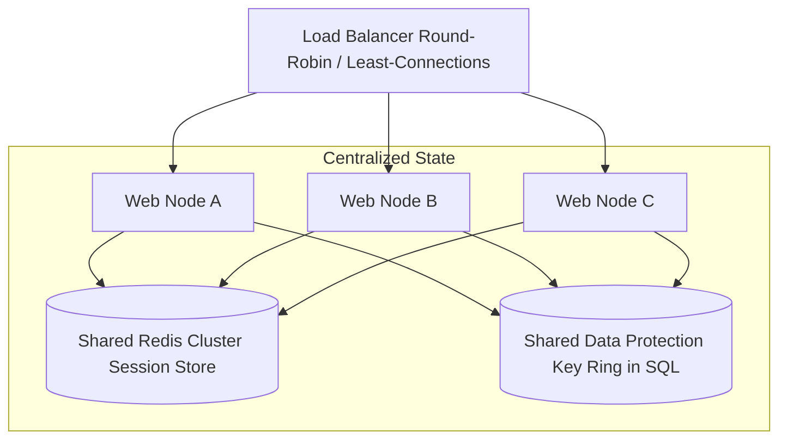
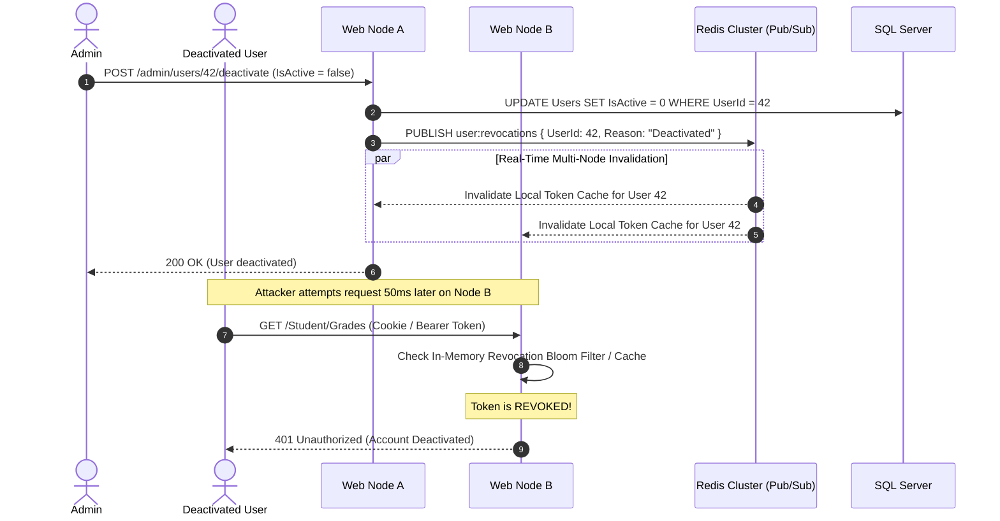

# Track 07 — Stateless Web Tier: Horizontal Scaling & Distributed Session Management

**Rank:** 07  
**Real-World Analogy:** AWS Auto Scaling Groups, Kubernetes multi-replica deployments, Zero-Downtime Blue/Green deployments.  
**Core Question:** When you run 3 instances of Academix behind a load balancer to handle peak exam traffic, why do users get randomly logged out on every other click, and how do you achieve a truly stateless web tier?

---

## Level 0: The Current Naive Baseline (What Exists Today)

### The Code in Academix
Look at [Program.cs:18-24](file:///p:/Projects/Learning%20Management%20System/Program.cs#L18-L24):
```csharp
// In-Memory Session Storage
builder.Services.AddSession(options =>
{
    options.IdleTimeout = TimeSpan.FromMinutes(30);
    options.Cookie.HttpOnly = true;
    options.Cookie.IsEssential = true;
    options.Cookie.SameSite = SameSiteMode.Lax;
});
```

And look at [SessionHelper.cs](file:///p:/Projects/Learning%20Management%20System/Helpers/SessionHelper.cs):
```csharp
public static int? GetUserId(ISession session)
{
    return session.GetInt32("UserId");
}
```

### Why Level 0 Fails
1. **The Multi-Instance Failure:** The default ASP.NET Core session provider stores session state **in the local RAM of the running process**.
   - If a student logs in through a load balancer, their login request hits **Instance A**. Instance A writes `UserId = 42` into its own RAM.
   - The student clicks "My Courses", and the load balancer routes the request to **Instance B**. Instance B looks in its local RAM, finds nothing, and redirects the student back to `/Auth/Login`!
2. **The Cryptographic Key Mismatch:** ASP.NET Core encrypts the session cookie using an encryption key from its **Data Protection Key Ring**. By default, this key is generated ephemerally on local disk. Instance B cannot decrypt cookies encrypted by Instance A, throwing a cryptographic exception.
3. **Deployment Disruption:** Every time you deploy a bugfix and restart the server, the process memory is wiped, forcefully logging out every active student currently taking an exam.

---

## Level 1: The First Immediate Fix (Sticky Sessions at the Load Balancer)

### The Solution
Configure the Load Balancer (NGINX, AWS ALB) with **Session Affinity (Sticky Sessions)**. The load balancer injects a tracking cookie (e.g., `AWSALB`) that forces all subsequent requests from that specific browser to be routed to the exact same server instance.

```nginx
# NGINX Sticky Session Configuration
upstream academix_cluster {
    server node1.internal:5000;
    server node2.internal:5000;
    sticky cookie srv_id expires=1h domain=.academix.edu path=/;
}
```

### The Emerging Bottleneck in Level 1: The Sticky-Session Trap
1. **Uneven Load Distribution:** If 500 students in a computer lab take an exam at the same time behind a shared NAT gateway, the load balancer may route all 500 students to **Node 1**. Node 1's CPU spikes to 100% and crashes, while Node 2 sits completely idle!
2. **Zero-Downtime Deployments Are Impossible:** When you take Node 1 offline for a rolling deployment, all 500 active sessions pinned to Node 1 are instantly destroyed.
3. **Horizontal Auto-Scaling Fails:** You cannot automatically scale out by adding Node 3, because existing sticky sessions will not migrate to the new node until their cookies expire.

---

## Level 2: The Architectural Refactor (Shared Redis Session & Centralized Data Protection)

### The Concept
Make the web tier **completely stateless** by externalizing both the session state and the cryptographic keys into shared infrastructure:
1. Store session dictionaries in a shared **Distributed Cache (Redis)** using `Microsoft.Extensions.Caching.StackExchangeRedis`.
2. Persist ASP.NET Core Data Protection encryption keys in **SQL Server or Redis** so every node can encrypt and decrypt each other's cookies.



### Configuring Stateless .NET 8 in `Program.cs`
```csharp
// 1. Shared Data Protection Key Ring in SQL Server
builder.Services.AddDataProtection()
    .PersistKeysToDbContext<LmsContext>()
    .SetApplicationName("AcademixLMS");

// 2. Shared Distributed Session in Redis
builder.Services.AddStackExchangeRedisCache(options =>
{
    options.Configuration = builder.Configuration.GetConnectionString("RedisConnection");
    options.InstanceName = "Academix_Session_";
});

builder.Services.AddSession(options =>
{
    options.IdleTimeout = TimeSpan.FromMinutes(30);
    options.Cookie.HttpOnly = true;
    options.Cookie.SameSite = SameSiteMode.Lax;
});
```

### The Emerging Bottleneck in Level 2: The Stale Session / Invalidation Gap
1. **Stale Deactivation (Security Finding F-08):** If an Admin deactivates an abusive user (`User.IsActive = false`), their session in Redis remains valid for 30 minutes. Because controllers only check `session.GetInt32("UserId") != null`, the deactivated user can continue taking quizzes and viewing courses until their session cookie naturally expires.
2. **Network I/O on Every Request:** Every single HTTP request deserializes the entire session object from Redis over the network, adding 1–3ms of network latency per request.

---

## Level 3: Production-Grade Architecture (Token-Based Auth, Sliding Refresh & Pub/Sub Revocation)

### The Complete Production Architecture



### Production Patterns Implemented
1. **Short-Lived Access Tokens (JWT) + Stateful Refresh Tokens:**
   - Client holds a short-lived (15-minute) cryptographic JWT access token for stateless API authorization.
   - For sensitive state changes, a sliding-window Refresh Token is verified in Redis.
2. **Instant Multi-Node Session Revocation via Redis Pub/Sub:**
   - When an admin locks an account or a user changes their password:
     ```csharp
     // Publish revocation event
     await _redisSubscriber.PublishAsync("user:revocations", JsonSerializer.Serialize(new UserRevokedEvent(userId)));
     ```
   - All web nodes subscribe to this channel. They immediately blacklist the token in a fast local cache, evicting the user in <10ms across the entire fleet.
3. **Liveness & Readiness Health Probes:**
   - Add `/health/live` (cheap process check) and `/health/ready` (validates Redis and SQL Server connectivity) to enable seamless zero-downtime rolling deployments in Kubernetes or AWS ECS.

---

## Hands-on Failure Injection & Verification Challenge

### Exercise: Multi-Node Session Continuity & Kill Test
Using Docker Compose, spin up 2 web nodes (`web-1`, `web-2`) behind an NGINX round-robin load balancer.

```csharp
[Fact]
public async Task Session_Persists_When_Alternating_Between_Nodes()
{
    var cookieContainer = new CookieContainer();
    using var handler = new HttpClientHandler { CookieContainer = cookieContainer };
    using var client = new HttpClient(handler) { BaseAddress = new Uri("http://localhost:8080") };

    // Act 1: Login (Request routed to Node 1)
    var loginResponse = await client.PostAsync("/Auth/Login", loginPayload);
    Assert.True(loginResponse.IsSuccessStatusCode);

    // Act 2: Next request routed to Node 2 by load balancer
    var dashboardResponse = await client.GetAsync("/Student/Dashboard");
    
    // Assert: Node 2 must recognize the session seamlessly
    Assert.Equal(HttpStatusCode.OK, dashboardResponse.StatusCode);
    Assert.DoesNotContain("Login", dashboardResponse.RequestMessage.RequestUri.ToString());
}
```

### Verification Questions to Answer
1. Why does a shared Data Protection key ring matter just as much as a shared Redis session store?
2. What are the major tradeoffs between Stateful Redis Sessions vs. Stateless JWT Tokens?
3. What is the difference between a Liveness Probe and a Readiness Probe during rolling application updates?
