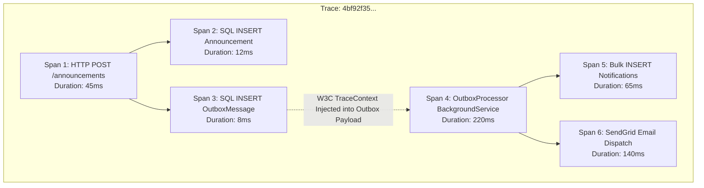
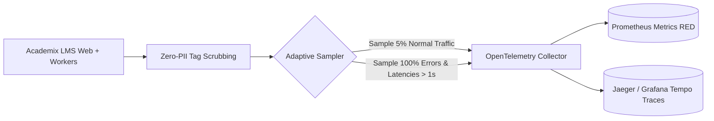

# Track 08 — Distributed Observability: OpenTelemetry & Distributed Tracing

**Rank:** 08  
**Real-World Analogy:** Datadog APM, Honeycomb distributed tracing, Jaeger, AWS X-Ray.  
**Core Question:** Once you have decoupled background workers, outbox tables, Redis caches, and multiple web instances, how do you trace a single user action end-to-end to find out why an exam submission took 4.2 seconds or why a notification was dropped?

---

## Level 0: The Current Naive Baseline (What Exists Today)

### The Code in Academix
Look at [Program.cs](file:///p:/Projects/Learning%20Management%20System/Program.cs) and [Controllers/](file:///p:/Projects/Learning%20Management%20System/Controllers/):
There is no telemetry instrumentation configured. The application uses only default unstructured console logging:

```csharp
// Unstructured, disconnected console logs:
_logger.LogInformation("Submitting quiz attempt {AttemptId}", model.AttemptId);
```

### Why Level 0 Fails
1. **The Distributed Black Hole:** In an asynchronous architecture, an HTTP request enqueues a message into an Outbox table. A background worker picks it up 10 seconds later on an entirely different thread or container. If that worker throws an exception, **there is zero link** between the error log and the original student or instructor who initiated the action.
2. **Invisible Latency Bottlenecks:** When a student reports that "Submitting an exam took 8 seconds", plain logs cannot tell you where the time went: was it network latency, a lock wait in SQL Server, or an un-indexed stored procedure?

---

## Level 1: The First Immediate Fix (HTTP Correlation ID Middleware)

### The Solution
Add an ASP.NET Core middleware that extracts or generates a `Correlation-ID` header and pushes it into the logging scope:

```csharp
public class CorrelationIdMiddleware
{
    private readonly RequestDelegate _next;

    public CorrelationIdMiddleware(RequestDelegate next) => _next = next;

    public async Task InvokeAsync(HttpContext context, ILogger<CorrelationIdMiddleware> logger)
    {
        var correlationId = context.Request.Headers["X-Correlation-ID"].FirstOrDefault() 
            ?? Guid.NewGuid().ToString();

        context.Response.Headers["X-Correlation-ID"] = correlationId;

        using (logger.BeginScope(new Dictionary<string, object> { ["CorrelationId"] = correlationId }))
        {
            await _next(context);
        }
    }
}
```

### The Emerging Bottleneck in Level 1: The Async Boundary Disconnect
1. **Lost Context in Background Queues:** As soon as you push work into a `Channel<T>`, an `OutboxMessages` table, or a background thread, the HTTP logging scope is disposed. The background worker logs messages with an empty or new correlation ID.
2. **No Hierarchy or Timing:** A flat Correlation ID string cannot tell you parent-child relationships between operations (e.g., "Request started $\to$ Database query took 120ms $\to$ Cache lookup took 2ms").

---

## Level 2: The Architectural Refactor (OpenTelemetry & W3C Trace Context)

### The Concept
Adopt the industry standard: [**OpenTelemetry**](https://opentelemetry.io/) with the [**W3C TraceContext**](https://www.w3.org/TR/trace-context/) specification.
Every distributed operation is represented by a **Trace** composed of multiple **Spans**:
- `TraceId`: Globally unique ID for the entire end-to-end journey.
- `SpanId`: Unique ID for a single operation unit (e.g., an HTTP action or a SQL query).
- `traceparent` Header: Propagated across network calls and message queues:
  $$\text{traceparent: 00-4bf92f3577b34da6a3ce929d0e0e4736-00f067aa0ba902b7-01}$$



### Configuring OpenTelemetry in .NET 8
```csharp
builder.Services.AddOpenTelemetry()
    .WithTracing(tracing => tracing
        .AddSource("Academix.LMS")
        .SetResourceBuilder(ResourceBuilder.CreateDefault().AddService("Academix.Web"))
        .AddAspNetCoreInstrumentation(opts => opts.RecordException = true)
        .AddHttpClientInstrumentation()
        .AddEntityFrameworkCoreInstrumentation(opts => opts.SetDbStatementForText = true)
        .AddOtlpExporter()); // Exports to Jaeger / OpenTelemetry Collector
```

### Propagating Trace Context Across Outbox Boundaries
When saving to the Outbox:
```csharp
// Inject active W3C trace context into outbox metadata
var activity = Activity.Current;
var outboxMessage = new OutboxMessage
{
    EventType = "AnnouncementCreated",
    Payload = payloadJson,
    TraceParent = activity?.Id // e.g. "00-4bf92f35...-01"
};
```

When the background worker consumes the outbox message:
```csharp
// Extract and resume the exact parent trace!
var parentContext = ActivityContext.Parse(outboxMessage.TraceParent, null);
using var activity = _activitySource.StartActivity("ProcessOutboxMessage", ActivityKind.Consumer, parentContext);
```

### The Emerging Bottleneck in Level 2: High Cardinality & Volume Explosion
1. **Telemetry Overload:** Emitting detailed spans and logs for every single health probe, auto-save ping, and SQL query at 10,000 requests/sec generates gigabytes of telemetry data, leading to massive cloud observability bills (Datadog/NewRelic).
2. **Sensitive Data Leakage:** Capturing raw SQL statements and HTTP payloads risks logging student passwords, quiz answers, and personal identities.

---

## Level 3: Production-Grade Architecture (Adaptive Sampling, RED Metrics & Zero-PII)

### The Complete Production Architecture



### 1. The RED Method for Metrics
Rather than relying solely on traces, track low-overhead counters and histograms:
- **R**ate: Number of requests/operations per second (`Meter.CreateCounter<long>("quiz.submissions.count")`).
- **E**rrors: Number of failed operations per second (`Meter.CreateCounter<long>("quiz.submissions.errors")`).
- **D**uration: Histogram of latency distribution p50, p95, p99 (`Meter.CreateHistogram<double>("quiz.submissions.duration.ms")`).

```csharp
public static class AcademixMetrics
{
    private static readonly Meter _meter = new("Academix.LMS.Core", "1.0.0");
    public static readonly Counter<long> QuizSubmissions = _meter.CreateCounter<long>("quiz_submissions_total");
    public static readonly Histogram<double> SubmissionDuration = _meter.CreateHistogram<double>("quiz_submission_duration_ms");
}
```

### 2. Adaptive (Tail-Based) Sampling
Configure your OpenTelemetry pipeline to discard boring 200 OK health checks, while capturing **100% of exceptions and slow requests** exceeding 1,000ms.

### 3. Strict Zero-PII Scrubbing
Enforce a policy filter that redacts passwords, student emails, and answers before telemetry leaves the process boundary.

---

## Hands-on Failure Injection & Verification Challenge

### Exercise: Tracing an Asynchronous Failure Across Boundaries
Run an integration test where an announcement is enqueued, but the outbox worker encounters a simulated database failure.

```csharp
[Fact]
public async Task Outbox_Failure_Retains_Original_HTTP_TraceId()
{
    // Arrange: Start an explicit activity representing the HTTP request
    using var activity = new Activity("HttpSendAnnouncement").Start();
    var originalTraceId = activity.TraceId;

    // Act: Enqueue outbox message with trace context
    var outboxId = await EnqueueOutboxMessageWithTraceContext(activity.Id);

    // Run worker with simulated failure
    await RunWorkerWithInjectedFailure(outboxId);

    // Assert: Verify the logged failure event retains the original TraceId
    var failureLog = await GetLatestErrorLogForOutbox(outboxId);
    Assert.Equal(originalTraceId.ToString(), failureLog.TraceId);
}
```

### Verification Questions to Answer
1. Why does W3C TraceContext use a standardized `traceparent` string instead of custom proprietary headers?
2. How does the RED method (Rate, Errors, Duration) complement distributed tracing?
3. What is the difference between Head-Based Sampling (at request start) and Tail-Based Sampling (at request completion)?
