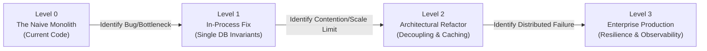

# Academix LMS — System Design Learning Curriculum

Welcome to the hands-on **System Design Engineering Curriculum** built directly inside the **Academix LMS** repository.

Most engineers learn System Design purely through theoretical books and whiteboarding interviews. However, real-world system design is not about memorizing buzzwords; it is about understanding **workload characteristics, failure modes, data invariants, and evolutionary refactoring**.

---

## The Pedagogical Approach: Evolutionary Architecture ("Levels of Maturity")

Instead of jumping straight into a complex, distributed cloud architecture, every track in this curriculum is structured into **Evolutionary Levels**:



1. **Level 0: The Current Naive Baseline:** What the code does today in Academix, where the exact code lines live, and how it fails under real load or unexpected crashes.
2. **Level 1: The First Immediate Fix & Its Emerging Bottleneck:** We write the simplest possible fix using relational database invariants or clean in-process code. It solves the immediate bug, but as traffic multiplies, a **new bottleneck or failure point appears**.
3. **Level 2: The Architectural Refactor & Its New Trade-offs:** We refactor Level 1 into a decoupled, buffered, or cached design. We learn *why* the architectural pattern is required, but we observe the new distributed edge cases it introduces (e.g., dual-write inconsistencies, cache staleness).
4. **Level 3: Production-Grade Resilient Architecture:** We harden the system with enterprise patterns (Idempotency Keys, Dead Letter Queues, Stampede Mutexes, Leases, Distributed Tracing) to make it bulletproof.
5. **Hands-on Failure Injection & Verification:** Exact steps to simulate network failures, worker crashes, and race conditions locally using test harnesses.

---

## Ranked Curriculum Map

Each track is ranked based on **pedagogical dependency** (mastering single-node relational concurrency first before tackling asynchronous outboxes, distributed caches, and multi-instance stateless clusters):

| Rank | Track | System Design Concepts | Primary Code Anchors |
| :---: | :--- | :--- | :--- |
| **01** | [**Reliable Notification & Announcement Engine**](file:///p:/Projects/Learning%20Management%20System/docs/system-design/01-reliable-notification-system.md) | Dual-Write Problem, Transactional Outbox Pattern, At-Least-Once Delivery, Idempotent Consumer, Dead Letter Queue (DLQ), High Fan-Out Batching | [InstructorController.cs:1062-1135](file:///p:/Projects/Learning%20Management%20System/Controllers/InstructorController.cs#L1062-L1135), [StudentController.cs:170-173](file:///p:/Projects/Learning%20Management%20System/Controllers/StudentController.cs#L170-L173) |
| **02** | [**Course Enrollment & Seat Reservation**](file:///p:/Projects/Learning%20Management%20System/docs/system-design/02-course-enrollment-concurrency.md) | Race conditions (TOCTOU), Compare-And-Swap (CAS), Optimistic Concurrency Control (OCC), RowVersion, Redis TTL Leases | [AdminController.cs:1100-1123](file:///p:/Projects/Learning%20Management%20System/Controllers/AdminController.cs#L1100-L1123), [Course.cs](file:///p:/Projects/Learning%20Management%20System/Models/Course.cs) |
| **03** | [**High-Concurrency Quiz Engine**](file:///p:/Projects/Learning%20Management%20System/docs/system-design/03-high-concurrency-quiz-engine.md) | Flash crowd write spikes, Write-Behind Buffer, Atomic State Machine, Server-Authoritative Clocks (`TimeProvider`), Double-Submit Prevention | [StudentController.cs:404-442](file:///p:/Projects/Learning%20Management%20System/Controllers/StudentController.cs#L404-L442), [StudentController.cs:603-674](file:///p:/Projects/Learning%20Management%20System/Controllers/StudentController.cs#L603-L674) |
| **04** | [**Read-Heavy Dashboards & Real-Time Push**](file:///p:/Projects/Learning%20Management%20System/docs/system-design/04-read-heavy-dashboards-caching.md) | CQRS, Cache-Aside (Look-Aside), Thundering Herd / Cache Stampede Guard, Materialized Projections, WebSockets / SignalR Push | [AdminController.cs:37-109](file:///p:/Projects/Learning%20Management%20System/Controllers/AdminController.cs#L37-L109), [StudentController.cs:725-760](file:///p:/Projects/Learning%20Management%20System/Controllers/StudentController.cs#L725-L760) |
| **05** | [**Resilient AI Generation Pipeline**](file:///p:/Projects/Learning%20Management%20System/docs/system-design/05-resilient-ai-pipeline.md) | 3rd-Party Failure Isolation, Asynchronous Job Queue (202 Accepted), Token Bucket Rate Limiting, Polly Circuit Breaker, Semantic Cache | [AdminController.cs:98-104](file:///p:/Projects/Learning%20Management%20System/Controllers/AdminController.cs#L98-L104), [AigeneratedContent.cs](file:///p:/Projects/Learning%20Management%20System/Models/AigeneratedContent.cs) |
| **06** | [**Large Asset Ingestion & CDN Offloading**](file:///p:/Projects/Learning%20Management%20System/docs/system-design/06-asset-storage-cdn.md) | Bandwidth Offloading, Direct-to-Storage Pre-Signed URLs, Chunked/Resumable Uploads, Edge CDN Signed Cookies, Async Quarantine Scanning | [InstructorController.cs:433-475](file:///p:/Projects/Learning%20Management%20System/Controllers/InstructorController.cs#L433-L475), [LearningAsset.cs](file:///p:/Projects/Learning%20Management%20System/Models/LearningAsset.cs) |
| **07** | [**Stateless Web Tier & Distributed Sessions**](file:///p:/Projects/Learning%20Management%20System/docs/system-design/07-stateless-web-distributed-session.md) | Horizontal Scaling, Distributed Cache Session Store, Shared Data Protection Key Ring, Token-Based Auth (JWT + Sliding Refresh), Instant User Revocation | [Program.cs:18-24](file:///p:/Projects/Learning%20Management%20System/Program.cs#L18-L24), [SessionHelper.cs](file:///p:/Projects/Learning%20Management%20System/Helpers/SessionHelper.cs) |
| **08** | [**Distributed Observability & Telemetry**](file:///p:/Projects/Learning%20Management%20System/docs/system-design/08-observability-distributed-tracing.md) | OpenTelemetry, W3C Trace Context Propagation across Async Boundaries, RED Metrics (Rate, Error, Duration), Structured Context Scopes | [Program.cs](file:///p:/Projects/Learning%20Management%20System/Program.cs), [Controllers/](file:///p:/Projects/Learning%20Management%20System/Controllers/) |

---

## Recommended Step-by-Step Study & Execution Flow

```text
Phase 1: Asynchronous Communication & Reliability (Track 01)
   └─ Master the dual-write problem, transactional outbox, idempotency, and background worker lifetimes.

Phase 2: Invariants & Concurrency (Tracks 02 -> 03)
   └─ Master atomic operations, locks, and state transitions within a single SQL database.

Phase 3: High-Performance Reads & Caching (Track 04)
   └─ Master CQRS, cache stampedes, and real-time push protocols.

Phase 4: Distributed Boundaries & Fault Tolerance (Tracks 05 -> 06 -> 07 -> 08)
   └─ Master third-party resilience, cloud storage, stateless web clustering, and distributed tracing.
```

Start your journey with **[Track 01: Reliable Notification & Announcement Engine](file:///p:/Projects/Learning%20Management%20System/docs/system-design/01-reliable-notification-system.md)**!
